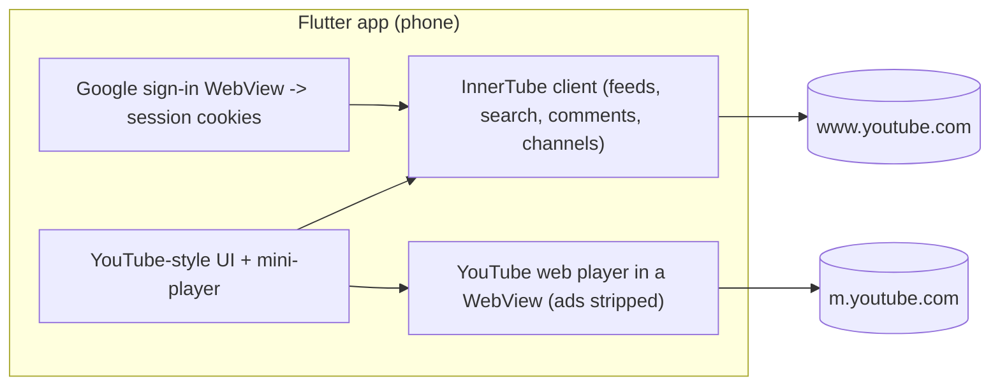

# Ad-Free YouTube Mobile App & Python API

An ad-free mobile YouTube client built with **Flutter**, using youtube.com directly as its backend.

---

## 🌟 Key Features

- **youtube.com is the backend:** the app calls YouTube's own web API (InnerTube) directly from the phone. No PC or server needs to be running.
- **Ad-Free Playback:** videos play in YouTube's own mobile web player (the only way most videos can be played now), with the ad data stripped out of every player response, ad requests blocked, and anything left over skipped and muted. Keeps playing in the mini-player, in the background and with the screen off.
- **Sign in with Google (optional):** your real Home feed, Subscriptions, History, Liked videos and Watch later; Like and Subscribe act on your account.
- **Works signed out too:** topic feeds (Music, Gaming, News, Sports, Live, Learning), with subscriptions/history/likes stored on the phone.
- **Feels like the YouTube app:** Home with chips and a Shorts shelf, a vertical Shorts player, a mini-player that keeps playing while you browse, comments, description, Up next with autoplay, channel pages.
- **Player:** YouTube's own player controls, plus quality picker, playback speed and audio-only mode. Watching counts towards your YouTube history when signed in.

---

## 🏗️ Architecture



---

## 📂 Project Structure

```text
youtube_ad/
├── mobile_app/lib/
│   ├── core/        # theme, formatting, navigation helpers
│   ├── models/      # VideoItem, VideoDetails, FeedPage, CommentPage, ChannelProfile
│   ├── providers/   # Auth, Feed, Search, Player, Library, Settings
│   ├── screens/     # Home, Shorts, Subscriptions, You, Search, Channel, Settings, Login
│   ├── services/    # innertube.dart, yt_parser.dart, api_service.dart, auth_service.dart, web_player.dart, google_oauth.dart
│   └── widgets/     # VideoCard, ShortsShelf, PlayerPanel (full + mini), chips
├── mobile_app/android/  # Android host (Kotlin: background playback service, OAuth redirect, cookies)
├── mobile_app/ios/      # iOS host (Swift: audio session, OAuth sheet, cookies)
└── start_all.bat    # launches the app with flutter run
```

---

## 🚀 How to Run

```bash
cd mobile_app
flutter run                      # connected Android phone / emulator, or iPhone / Simulator (on a Mac)
flutter build apk --release      # build an installable APK
```

### iOS

iOS builds need a Mac with Xcode (the `ios/` project cannot be built on Windows).

```bash
cd mobile_app
open ios/Runner.xcworkspace      # Runner target -> Signing & Capabilities: pick your Team
flutter run -d <iphone-id>       # or: flutter build ipa --release
```

- Bundle ID: `com.adfree.youtube.mobileApp`, minimum iOS 15.
- Background playback: `UIBackgroundModes = audio` plus an `AVAudioSession` in `.playback` mode, so videos keep playing on the lock screen and with the silent switch on.
- Native channels (`ios/Runner/AppDelegate.swift`) mirror `MainActivity.kt`: `wakelock` (audio session), `cookies` (`WKWebsiteDataStore`), `oauth` (`ASWebAuthenticationSession`).
- Google sign-in in the browser: create an **iOS** OAuth client for the bundle ID above in Google Cloud Console and paste it into `GoogleOAuth.iosClientId` (`lib/services/google_oauth.dart`). The redirect scheme is derived from it automatically.
